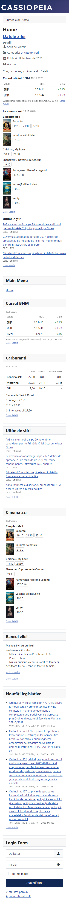
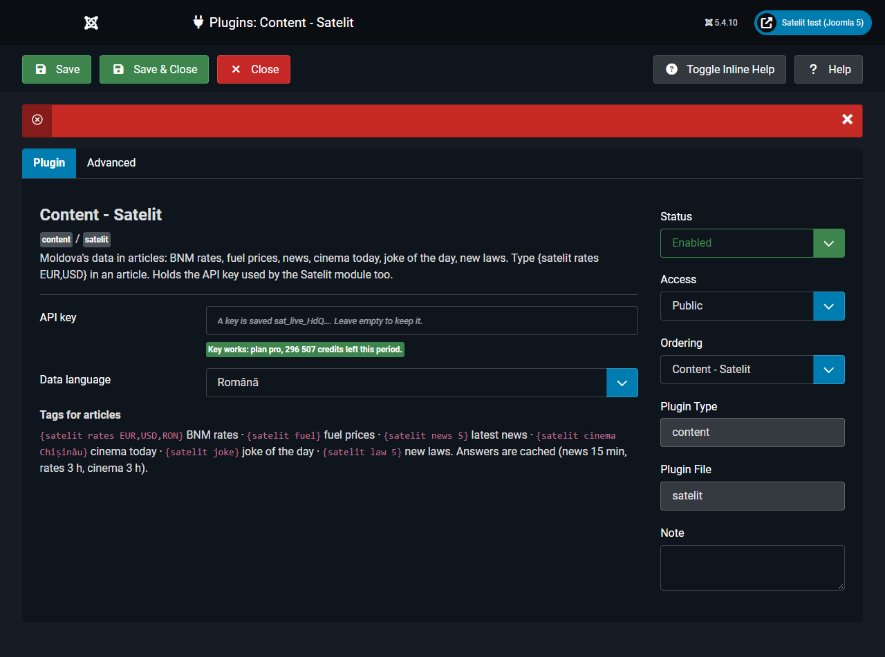

# Satelit for Joomla

Moldova's public data on a Joomla site, from the [Satelit API](https://developer.satelit.md/en/docs/): **BNM exchange rates, fuel prices, latest news, cinema today, joke of the day and new laws**. One package for **Joomla 3.10, 4 and 5**, for the city halls, schools, news portals and small businesses that still run them.

<p>


</p>

Real output of `{satelit rates EUR,USD}` on Joomla 3.10 (19 Nov 2026, live API):

```html
<div class="satelit satelit--rates"><h3 class="satelit__title">BNM exchange rates <small>19.11.2026</small></h3>
<table class="satelit__table">…<tr><th scope="row"><abbr title="Euro">EUR</abbr></th><td class="satelit__num">20.1411</td>
<td class="satelit__num"><span class="satelit__down">−0.1%</span></td></tr>
<tr><th scope="row"><abbr title="Dolar SUA">USD</abbr></th><td class="satelit__num">18.3744</td>…</table>
<p class="satelit__src">Sursa: Banca Națională a Moldovei, bnm.md, CC BY 4.0 · <a href="https://satelit.md" rel="noopener">Data: Satelit</a></p></div>
```

## What is in the package

`pkg_satelit-1.0.0.zip` installs three extensions:

| Extension | What it does |
|---|---|
| `mod_satelit` (site module) | One block per module, chosen in its settings: BNM rates, fuel prices, latest news, cinema today, joke of the day, new laws. |
| `plg_content_satelit` (content plugin) | Inline tags in articles. Holds the **API key** (one key for the site). Switched on by the installer. |
| `lib_satelit` (library) | The shared code: API client on Joomla's HTTP client, Joomla's cache, escaping, the HTML, en-GB / ro-RO / ru-RU labels, a small stylesheet. |

## Requirements

- Joomla 3.10 (PHP 7.2–8.0) or Joomla 4.x / 5.x (PHP 8.1+)
- A Satelit API key (`sat_live_…`): [console](https://developer.satelit.md/en/console/). Plans: [pricing](https://developer.satelit.md/en/pricing/). Trying the data before paying: the keyless [`/v1/sample`](https://api.satelit.md/v1/sample) and the console.

## Install

1. Download `pkg_satelit-1.0.0.zip` (GitHub Releases or the CI artifact), or build it: `php build/build.php` → `dist/pkg_satelit-1.0.0.zip`.
2. **System → Install → Extensions → Upload Package File** (Joomla 3: Extensions → Manage → Install).

Installing a newer zip over the old one updates it and keeps the key.

## Configure

**Extensions → Plugins → Content - Satelit**:

- **API key**: paste it and save. The field is always shown empty (the key never goes back to the browser). An empty field keeps the saved key, `-` removes it. After saving, the page says what the API answered, e.g. *Key works: plan pro, 297 173 credits left this period.*, or *The API did not accept the key or could not be reached (key_invalid)*.
- **Data language**: site language (ro-RO → Romanian, ru-RU → Russian, others English) or a fixed one.
- Advanced: **API address**, empty for `https://api.satelit.md/v1` (only for tests).

## Usage

**Module**: Content → Site Modules → New → *Satelit*, pick **Show** (rates, fuel, news, cinema, joke, law), its options and a position.

**Tags in an article** (also in a Custom module with *Prepare content* on):

| Tag | Shows | Credits per refresh |
|---|---|---|
| `{satelit rates EUR,USD,RON}` | BNM official rates, 7-day change | 1 |
| `{satelit fuel}` | A95 / diesel / LPG range, ANRE cap, cheapest networks | 1 |
| `{satelit news 5}` | Latest news with the outlet's link | 2 |
| `{satelit cinema Chișinău}` | Today's films and the sessions still to come | 40 |
| `{satelit joke}` | Joke of the day | 1 |
| `{satelit law 5}` | Important acts in the Official Gazette | 2 |

A tag alone in a paragraph replaces the whole paragraph. A mistyped tag stays visible, so an editor sees it. To restyle, copy `modules/mod_satelit/tmpl/default.php` into your template's `html/mod_satelit/` or override the `.satelit*` classes.

Every block shows the API's attribution when it has one (BNM's line under the rates) and a **Data: Satelit** link.

## Caching and credits

Answers are kept in Joomla's cache (group `satelit`, on even when the site's cache is off):

| Data | Fresh for |
|---|---|
| Rates | 3 h (BNM publishes once a day) |
| Fuel | 2 h |
| News | 15 min |
| Cinema today | 3 h (each call costs 40 credits) |
| Joke, laws | 6 h |

A busy site spends at most one call per block per period, whatever its traffic. A copy is kept 7 days: when the API cannot be reached or refuses the key, the last copy is shown and calls pause for 5 minutes (or the API's `Retry-After`), so a dead API never slows pages. With no key and no copy the module disappears and the tag is removed. The page stays up. One short line per failure goes to `administrator/logs/satelit.php`. **System → Clear Cache → satelit** forces fresh answers.

## Tested with

Verified on 19 Nov 2026 against the live API, with official Docker images: package uploaded through the installer form, key saved through the plugin form, six modules and one article with tags on the front page, the HTML checked against the API's own answers (EUR 20.1411 = `/v1/rates`, A95 from 27.90 = `/v1/fuel`, a `/v1/news` title, film *Badanta* and its session times = `/v1/movies/cinemas/today`, the joke and the first act).

| Joomla | PHP | Database | Checked |
|---|---|---|---|
| 3.10.11 (`joomla:3.10-php7.4-apache`) | 7.4.33 | MariaDB 10.11.19 | install, upgrade, key form, 6 modules + tags, dead API, bad key |
| 5.4.10 (`joomla:5-apache`) | 8.3.36 | MariaDB 10.11.19 | the same, plus ro-RO labels with the official Romanian pack |

Offline tests (PHPUnit 9.6) pass on PHP 7.4.33, 8.0.30 and 8.3.36. Joomla 4.x was not run. It uses the same classes as 5.x.

## Troubleshooting

| You see | Do |
|---|---|
| Module or tag shows nothing | Open Content - Satelit: the line under the key says why (`no_key`, `key_invalid`, `plan_required`, `network`). |
| `quota_exceeded` | The period's credits are spent: [pricing](https://developer.satelit.md/en/pricing/). Saved copies keep showing meanwhile. |
| Old data after fixing the key | System → Clear Cache → `satelit`. |
| `{satelit …}` stays as typed | The plugin is off, or the word after `satelit` is not one of rates, fuel, news, cinema, joke, law. |

Errors: [developer.satelit.md/en/errors/](https://developer.satelit.md/en/errors/). Limits: [/en/rate-limits/](https://developer.satelit.md/en/rate-limits/).

## Development

```sh
composer install
vendor/bin/phpunit                               # offline, no network
SATELIT_API_KEY=sat_live_… vendor/bin/phpunit --group live   # ~2 credits
php build/build.php                              # dist/pkg_satelit-1.0.0.zip
```

## Pe scurt (română)

Pachet Joomla (3.10, 4, 5) cu datele Moldovei din API-ul Satelit: cursul BNM, prețul carburanților, ultimele știri, cinema azi, bancul zilei, noutăți legislative. Instalați `pkg_satelit-1.0.0.zip` din Sistem → Instalare → Extensii, salvați cheia API în Extensii → Pluginuri → Conținut - Satelit, apoi adăugați un modul Satelit sau scrieți `{satelit rates EUR,USD}` într-un articol. Răspunsurile se păstrează în cache (știri 15 min, curs 3 h, cinema 3 h). Dacă API-ul nu răspunde, se arată ultima copie salvată, iar site-ul merge mai departe. Interfața are română, rusă și engleză.

## License

MIT, © 2026 Satelit (satelit.md). See [LICENSE](LICENSE). Security reports: [SECURITY.md](SECURITY.md).
